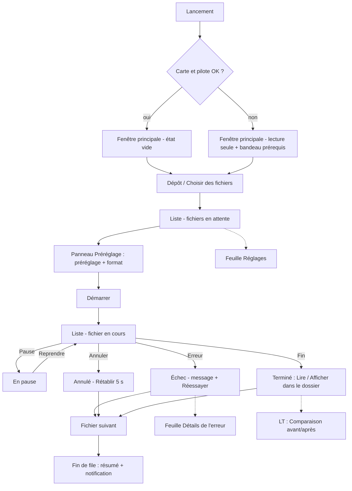

# Enhance — Architecture des écrans

Statut : v0.1 (ux-designer), 2026-10-21.

## Principe

**Une seule fenêtre, un seul écran permanent.** Tout le MVP se joue dans la fenêtre principale. Les éléments secondaires sont des feuilles (sheets) ou popovers ancrés à la fenêtre, jamais des fenêtres séparées. Total MVP : **1 fenêtre, 3 zones, 3 feuilles**.

## Arborescence

```
Fenêtre principale « Enhance »
├── Zone Liste (centre)            -> états : vide / liste / en cours / terminée
│     └── Carte de fichier         -> états : lecture, en attente, en cours, en pause, terminé, échec, annulé
├── Panneau Préréglage (bas)       -> préréglage, format, estimation, bouton Démarrer / Pause
├── Barre d'état (pied)            -> carte graphique, synthèse globale, messages discrets
├── Bandeaux (haut de la liste)    -> prérequis (pilote/carte), espace disque, fichiers refusés
├── Feuille « Réglages »           (Ctrl+,)  dossier de sortie, thème, journaux, à propos
├── Feuille « Détails de l'erreur » (depuis une carte en échec)
└── Feuille « Raccourcis »         (?  ou  Ctrl+/ )
[LT] Vue « Comparaison avant / après » (remplace la liste, Échap pour revenir)
[LT] Section « Avancé » dans le panneau Préréglage
```



## Justification des éléments

| Élément | Pourquoi il existe | Pourquoi pas autrement |
|---|---|---|
| Fenêtre unique | Le cœur est « déposer, choisir, lancer, attendre » | Un assistant en étapes ajouterait des clics |
| Panneau Préréglage visible dès qu'il y a un fichier | 2 choix suffisent, ils conditionnent l'estimation | Dans les Réglages, il serait oublié ou introuvable |
| Feuille Réglages | Usage rare (dossier, thème, journaux) | Pas de menu « Options » à plusieurs onglets |
| Feuille Détails de l'erreur | Garde la carte lisible, détail pour qui le veut | Pas de boîte modale technique |
| Feuille Raccourcis | Découvrabilité pour les habitués | Aussi dans les info-bulles |
| Pas d'écran de bienvenue ni d'assistant | Le dépôt EST le premier pas | -- |

## États de la zone Liste

| État | Contenu | Condition |
|---|---|---|
| Vide | Illustration, « Déposez vos vidéos ici », bouton « Choisir des fichiers… » ; panneau Préréglage **masqué** (rien à régler) | Aucun fichier |
| Survol de dépôt | Surbrillance de toute la zone, « Relâcher pour ajouter N vidéos » | Glisser actif |
| Liste en attente | Cartes empilées, panneau Préréglage visible, bouton « Démarrer (N) » | Fichiers, rien lancé |
| En cours | 1 carte déployée (progression), les autres compactes en attente ; Démarrer devient Pause | Traitement actif |
| En pause | Carte active grisée « En pause », bouton « Reprendre » | Pause |
| Terminée | Cartes terminées repliées en bas ou en haut (groupe « Terminées » repliable), résumé en pied | Tous les jobs finis |
| Mélangée avec erreurs | Cartes en échec mises en évidence, accent d'avertissement discret, bouton « Voir les erreurs » | >= 1 échec |
| Lecture seule | Bandeau prérequis, Démarrer désactivé avec info-bulle | Carte/pilote non conformes |

## États de la carte de fichier

| État | Aspect | Actions disponibles |
|---|---|---|
| Lecture | Squelette animé, nom visible | Retirer |
| En attente | Vignette, nom, « 12 min · 1280×720 · 30 i/s », estimation, pastille « 30 → 60 i/s » (toute source < 50 i/s, 31-49 incluses : décidé) ou « 60 i/s conservées » (>= 50 i/s), « MKV » si applicable | Retirer, déplacer (poignée), menu ⋯ |
| En cours | Carte déployée : barre, %, images/s, temps restant, étape | Pause, Annuler |
| En pause | Barre figée grisée, « En pause à 38 % » | Reprendre, Annuler |
| Terminé | Coche, « Terminé en 18 min · 2,3 Gio » | Lire, Afficher dans le dossier, Retirer |
| Échec | Pastille rouge discrète + phrase d'explication | Réessayer, Détails, Retirer |
| Annulé | « Annulé » + « Rétablir » (5 s) puis « Relancer » | Relancer, Retirer |

## Micro-textes (français, vouvoiement discret)

### Général
| Contexte | Texte |
|---|---|
| Titre de fenêtre | Enhance |
| Zone vide, titre | Déposez vos vidéos ici |
| Zone vide, sous-titre | Enhance les passe en 4K fluide, sur votre ordinateur. Rien n'est envoyé sur Internet. |
| Bouton alternatif | Choisir des fichiers… |
| Survol | Relâcher pour ajouter {n} vidéo(s) |
| Bouton principal | Démarrer ({n}) · Pause · Reprendre |
| Pied : GPU | GeForce RTX 5070 · prête |
| Pied : synthèse | {done} sur {total} terminées · il reste environ {durée} |
| Fin de file | {n} vidéo(s) terminée(s). · Tout afficher dans le dossier |
| Notification Windows | Enhance a terminé : {n} vidéo(s) prête(s). |
| Estimation initiale | Estimation en cours… |

### Préréglages et format
| Libellé | Description (une ligne) |
|---|---|
| Qualité max | La meilleure netteté. Prend plus de temps. |
| Équilibré (défaut) | Le bon compromis entre netteté et durée. |
| Rapide | Plus rapide, finesse un peu moindre. |
| Format : Compatible (HEVC) | Lisible presque partout. |
| Format : Compact (AV1) | Fichiers plus petits. Nécessite un lecteur récent. |
| AV1 indisponible | Cette carte ne sait pas produire ce format. |
| Interpolation | 30 → 60 images/s · 60 images/s conservées · Déjà en 4K : agrandissement ignoré |
| Bascule MKV | Ce film contient des sous-titres qui ne rentrent pas dans un fichier MP4. Il sera enregistré au format MKV pour les conserver. |

### Actions et retours annulables
| Contexte | Texte |
|---|---|
| Annulation | Traitement annulé. [Rétablir] |
| Retrait | « {nom} » retiré de la liste. [Annuler] — le fichier d'origine n'est pas touché |
| Doublon | « {nom} » est déjà dans la liste. |
| Refus | « {nom} » n'est pas une vidéo. Il n'a pas été ajouté. |
| Terminé | Terminé en {durée} · {taille} |
| Rassurance | Votre fichier d'origine n'a pas été modifié. |
| Fichier produit absent | Le fichier n'est plus à cet emplacement. |
| Détails | Détails · Copier le détail · Afficher les journaux |

### Erreurs et prérequis
Voir tableaux de `parcours.md` P-01 et P-08. Format de toute erreur : 1 phrase *quoi* + 1 phrase *quoi faire*, sans code ni sigle.

### Réglages (feuille)
Dossier de sortie : « À côté de la vidéo d'origine » (défaut) / « Choisir un dossier… » · Apparence : Sombre · Clair · Suivre le système · Afficher les journaux · À propos d'Enhance (version, « Aucune donnée n'est envoyée hors de cet ordinateur », licences tierces).

## Raccourcis clavier

| Action | Raccourci |
|---|---|
| Choisir des fichiers | Ctrl+O |
| Démarrer / Pause / Reprendre | Ctrl+Entrée ; Espace (si la liste a le focus et un job est actif) |
| Annuler le job en cours | Échap (avec Rétablir 5 s) ; sinon Ctrl+. |
| Retirer la sélection | Suppr |
| Déplacer la sélection | Alt+↑ / Alt+↓ |
| Sélectionner préréglage | Ctrl+1 / 2 / 3 (Qualité max / Équilibré / Rapide) |
| Basculer le format | Ctrl+F |
| Lire le fichier produit | Entrée sur une carte terminée |
| Afficher dans le dossier | Ctrl+Entrée sur une carte terminée (contextuel) |
| Réglages | Ctrl+, |
| Raccourcis | Ctrl+/ |
| Annuler le dernier retrait | Ctrl+Z |
| Quitter | Ctrl+Q (pendant un traitement : feuille « Quitter et abandonner le traitement en cours ? » ; la croix de la fenêtre réduit l'app dans la barre des tâches, le traitement continue ; décidé par le PO le 2026-10-21) |
| Parcourir la liste | ↑ / ↓ ; Tab / Maj+Tab entre zones |

Conflit à surveiller : Ctrl+Entrée a deux sens contextuels (liste vs carte terminée) ; à trancher avec l'ui-designer/qa si ambigu.
